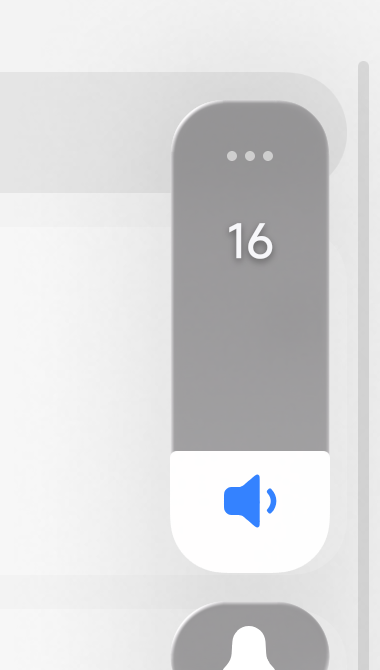
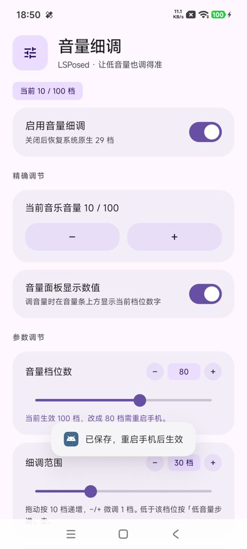

# Hyper音量细调

**把小米/HyperOS 的 29 级音量，变成 100 级可调。** 低音量区不再"不是高了就是低了"。

LSPosed 模块 · 需 root · 基于 libxposed **API 102** · 作用域：系统框架 + 系统界面

[](https://github.com/USAMA6878786/HyperVolumeFine/releases)
[](#许可证)

<p align="center">
  
</p>

---

## 它能做什么

- **100 级音量**：把音乐流从 29 档提升到 100 档（框架和音频 HAL 同步生效），每级只占音量曲线 1%
- **低音量区更细**：默认 0~30 档每按一次走 1 档，30 档以上每步 4 档，避免调一次跳太远
- **滑条也能停准**：拖音量条时会吸附到整数档，不会卡在 47.3 档这种位置
- **面板内显示档位**：调音量时在系统音量面板里直接显示当前是第几档（画在面板窗口内部，不是悬浮窗）
- **低音量区更细**：细调区间内每按一次走「低音量步进」档（默认 1），越过区间按「高音量步进」档（默认 4）
- **参数可视化调**：档位数、细调区间、步进、吸附粒度都有界面可调，改完提示重启生效

| 音量面板 | 改动提示 |
|---|---|
|  |  |

---

## 安装

1. 到 [Releases](https://github.com/USAMA6878786/HyperVolumeFine/releases) 下载最新 APK 并安装
2. 打开 **LSPosed** → 启用「Hyper音量细调」
3. 作用域勾选 **系统框架** 和 **系统界面**（两个都要）
4. 重启手机
5. 重启后打开本模块，确认「启用」是开着的（默认开）

> 首次使用默认就是 100 档。想改档位数请在 App 里改，改完**需要重启手机**才生效。

---

## 兼容性

开发和实测机型：**小米 13（fuxi）/ HyperOS 4.0 / Android 17**。

原理上依赖 `AudioService` 的 `ro.config.media_vol_steps` 与 `VolumeStreamState`，理论适用大多数 Android 13+ 设备，
但**只在上述机型验证过**。其他机型请先自行备份、谨慎尝试；面板内数字显示部分依赖 MIUI 自己的
`MiuiVolumeSeekBar`，非 MIUI 机型会自动退回不显示数字（其余功能不受影响）。

---

## 常见问题

**改了档位数没生效？**
必须重启手机。档位数是在 `AudioService` 构造时注入的，只在系统启动时读一次。

**音量面板里没有数字？**
确认作用域里勾了「系统界面」，并重启过手机；非 MIUI 面板不会显示。

**会不会影响其他音频流？**
默认只处理音乐流（`STREAM_MUSIC`）。闹钟、通话等保持系统原生行为。

---

## 实现原理（写给想改的人）

针对小米 13（fuxi / HyperOS 4.0 / Android 17）实测开发，用 **API 102**（libxposed 新 API）编写。

解决的问题：低音量按音量键时，"加一格太响、减一格太轻"，调不到合适的音量。

## 一、问题根因（实机逆向确认）

这台机器的音乐流（`STREAM_MUSIC`）档位数由 `ro.config.media_vol_steps=29` 决定，链路是这样的：

| 层级 | 数值 |
|---|---|
| 系统设置里存的音量（`volume_music_speaker`） | 0 ~ 29（"用户档位"） |
| `AudioService` 内部索引 `mIndexMax` | 0 ~ 290（档位 × 10） |
| 每次按音量键的内部步长 | ±10（正好 1 档） |
| 下发给 AudioPolicy 的索引 | 0 ~ 29（`APM` 该音量组 `Index Max = 29`） |
| 音量曲线（`/vendor/etc/audio_policy_volumes.xml`，扬声器） | 0 ~ 150，但被归一化到 29 档 |

也就是**真实可用的音量级数只有 29 级**，每级占音量曲线的 3.4%。
扬声器曲线在低音量区很陡（0:-75dB、1:-73dB、2:-64.5dB、7:-58dB），
所以低音量下一格就有 3~8dB 的跳变，听感上就是"不是高了就是低了"。

> 注：内部 290 的索引空间只是 10 倍细分，`mIndexStepFactor` 又把它除回去，
> 所以在这个 ROM 上"用内部小步长"是听不出差别的——必须真正提高 APM 的档位数。

## 二、模块做了什么

1. **提高真实档位数**：在 `AudioService` 构造阶段拦截
   `SystemProperties.getInt("ro.config.media_vol_steps")`，让它返回 100。
   `AudioService` 随后把 100 同时用于 `MAX_STREAM_VOLUME[3]`（框架）和
   `setMaxVolumeIndexForGroup(4, 100)`（音频策略），于是**框架和 HAL 都变成 100 级**，
   每级只占曲线 1%，低音量区每格约 1~2dB。
2. **接管每次按键的步长**（hook `VolumeStreamState#adjustIndex`）：
   档位变多后框架自己算出的步长会变成 4 档/次，所以必须自己接管：
   - 低音量区（默认 0~30 档）：每按一次 **N 档**（N 可配 1~6，默认 1，可设 2/3）；
   - 高音量区：每按一次 **4 档**，避免从静音调到最大要按 100 下。
3. **滑条吸附**（hook `VolumeStreamState#setIndex`）：拖动系统音量滑条时把索引
   吸附到 N 档网格（默认 2），滑条少一半落点，更容易停准；按键路径走 ThreadLocal
   标记跳过吸附，两边粒度互不干扰。
4. **音量数字直接画进系统音量面板**（v1.5 起）：
   - SystemUI 进程里 hook `WindowManagerImpl/WindowManagerGlobal.addView`，命中音量面板窗口
     （`type=2020`，HyperOS 上是这个值；AOSP 是 2014；或标题含 `VolumePanel`）后，
     把数字 TextView 加进**面板窗口自己的** content 容器，并 `bringToFront()`（面板的 UI 是后加的，会盖住我们）。
   - 数字是面板内的**一段纯文字**（没有自己的背景板），画在面板内部、三点图标下方、水平居中；
     压到白色填充上时自动切成深色，任何音量下都看得清。
   - 位置策略（v1.7 重写）：面板内部是 MIUI 自绘的 `MiuiVolumeSeekBar`，但**每次弹出面板，它的
     window 坐标都会累积右移十几像素**，逐帧跟随会让数字越点越偏。所以改成：等动画稳定（连续两次
     测量一致）后**标定一次**，把相对屏幕右边缘的距离、顶部位置、宽高换算成 dp 缓存，之后一律复用 —— 
     分辨率/机型仍然自适应，但不再随弹面板次数漂移。
   - 只在稳定时定位，避免频繁 `updateViewLayout` 干扰 MIUI 的滑入/滑出动画；
     面板开始退出（测不到滑条或位置重新变化）时数字同步淡出，不会比滑条多留一秒。
   - 面板窗口可能被系统复用、内容重建会把我们的 View 摘掉，轮询里检测到掉挂会自动补挂。
   - 出场时机（v1.8）：标定过之后，面板窗口一创建就按缓存坐标摆好并开始 240ms 淡入，
     不再等布局稳定 —— 数字和滑条几乎同时出现；只有重启后的第一次弹面板需要先标定一次。
   - 代价：模块作用域多了 `com.android.systemui`；依赖 MIUI 的 `MiuiVolumeSeekBar` 类名，
     面板结构大改时可能取不到位置（此时退回 dp 锚点，不会崩）。标定值在 SystemUI 进程内缓存，
     重启后首次弹出面板时重新标定。
   - **v2.3 起彻底删除悬浮窗**：不再有 system_server 侧的第二套显示与兜底逻辑，
     `volume_fine_inpanel_ok`、`volume_fine_badge_dx/dy` 这些键都已移除。
     “启用”和“显示数值”两个开关改为在 SystemUI 侧读取（1 秒缓存），直接控制面板内的数字。

5. **关闭时安全回落**：模块关闭（`volume_fine_enabled=0`）时，会把之前写大的
   音量设置值按 29/100 比例缩回，避免系统把它截断成"最大音量"炸响。

## 三、实机验证结果（小米 13，2026-11-11）

```
# 模块加载
module loaded, process=system
stream 3 volume steps: 15 -> 100
override ro.config.media_vol_steps -> 100
volume group 4 maxIndex=100          # 音频策略层同步为 100
updateIndexFactors stream=3 max=1000 # 内部索引空间 0~1000

# dumpsys audio：Max 从 29 变成 100
- STREAM_MUSIC:  Min: 0  Max: 100

# 按键实测（日志）
cur=250 step 60 -> 10    # 低音量区：框架想走 4 档，被改成 1 档
cur=290 step 60 -> 10
cur=300 step 60 -> 40    # 超过阈值：走 4 档
cur=340 step 60 -> 40
# 对应下发到 HAL 的索引：29 → 28 → 27 …（每次 1 级，共 100 级可用）
```

## 四、配置界面（Material 3）

模块自带一个 Material 3 风格设置页（无 AppCompat/Material 依赖，纯框架控件 + 自定义 drawable 实现，
所以在没有 Gradle 的环境里也能编译）：

- M3 基线色板：`vf_surface #FEF7FF` / `vf_surface_container #F3EDF7` / `vf_primary #6750A4`，
  并提供 `values-night` 深色色板（`#141218` / `#211F26` / `#D0BCFF`），跟随系统深浅色自动切换；
- 24dp 圆角卡片、primary container 数值胶囊、底部 tonal 按钮；
- 自绘 `M3Switch`：未选中 16dp 拇指 + 2dp 描边轨道，选中 24dp 拇指 + primary 实心轨道，180ms 强调曲线动画；
- 自绘滑块轨道/拇指（4dp 轨道、20dp 拇指），并让出状态栏/导航栏（targetSdk 35+ 强制 edge-to-edge）；
- 顶部状态胶囊与「精确调节」卡片实时显示当前音量，并提供 −/+ 按钮（按配置的步长精确调整）；
- 每个参数卡片右侧都有 `− 数值 +` 步进器：大范围参数（档位数 / 细调范围）的滑条按 **10 档** 分段，
  拖动一格正好 ±10，需要 91 这种非整十值就用 −/+ 微调 1 档；
- 档位数与运行中的档位不一致时，卡片说明会变紫提示"需重启"；改动弹 Toast「已保存，重启手机后生效」。
  Toast 做了去抖：拖动过程中不弹，停手 700ms 后只弹一次；同一句话 2 秒内不重复（v1.6 修复了拖动时刷屏的问题）。

### 配置怎么落盘（重要）

第三方 App 无权往 `Settings.System` 写自定义键，系统会抛
`You cannot keep your settings in the secure settings`（旧版就是这样"看起来改了其实没保存"）。
所以现在的通道是：

```
模块 App（内存改值） --广播 io.github.usama6878786.hypervolumefine.ACTION_CONFIG--> system_server 里的模块
                                                                      |
                                                          Settings.System（模块有权写）
```

读取路径仍是本地 `Settings.System`，不引入跨进程阻塞；广播会校验发送者 uid，
adb 直接 `settings put` 也依然有效。

## 五、安装 / 启用

```bash
# 1. 安装
adb install -r --no-incremental VolumeFine-2.4.apk

# 2. 在 LSPosed 管理器里启用模块，作用域勾选「系统框架」(system) 和「系统界面」(com.android.systemui)，
#    然后重启手机（模块声明了 staticScope，两个作用域已写在 APK 的 scope.list 里）

# 3. 想改参数可以打开「Hyper音量细调」App，或用 adb：
adb shell settings put system volume_fine_steps 100      # 档位数，15~120
adb shell settings put system volume_fine_threshold 30   # 低于该档位时每次 1 档
adb shell settings put system volume_fine_coarse 4       # 高于阈值时每次几档
adb shell settings put system volume_fine_enabled 1      # 0 = 关闭
adb shell settings put system volume_fine_debug 0        # 1 = 输出详细日志
```

App 内修改需要「修改系统设置」权限（首次打开会有提示，点一下授权即可）。

## 六、注意事项

- **改「音量档位数」和开关需要重启手机**（`AudioService` 只在启动时读取）；其余参数立即生效。
- App 里的改动依赖模块在 `system_server` 中运行：如果模块没启用，App 会显示数值但改动不会落盘。
- **不要直接在 LSPosed 里停用模块**：系统里存的音量值最大到 100，而原生只有 29 档，
  停用后开机音量会被截断成最大。正确做法是把 App 里的开关关掉（会先缩放回安全范围）再停用。
- 换成新音频设备（耳机/蓝牙）时音量可能与当前不同，这是系统按设备分别记录音量的正常行为。
- 只作用于 `STREAM_MUSIC`（streamType=3），铃声/闹钟/通知保持系统原生 15 档。
  如需扩展：`settings put system volume_fine_streams "2,3,4,5"`（重启生效）。
- 音量曲线本身的形状（0~1 档之间 -75dB→-73dB 的陡峭段）来自厂商 `/vendor` 配置，
  模块不修改它；这里改善的是"每一格跨多少曲线"。

## 七、工程结构

```
volume-fine/
├── AndroidManifest.xml                     # 包名 io.github.usama6878786.hypervolumefine，theme=VfTheme
├── build.sh                                # aapt2 + javac + d8 + apksigner，无需 Gradle
├── enable.sh                               # 开发用：写 LSPosed 数据库启用模块并重启
├── res/
│   ├── values/{colors,bools,styles}.xml    # M3 浅色色板 / 主题
│   ├── values-night/{colors,bools,styles}.xml
│   └── drawable/                           # 卡片、胶囊、滑块轨道/拇指、按钮、图标
└── src/main/
    ├── java/io/github/usama6878786/hypervolumefine/
    │   ├── VolumeFineModule.java           # system_server 侧 hook 主体（API 102）
    │   ├── PanelNumber.java                # SystemUI 侧：把数字画进音量面板
    │   ├── SettingsActivity.java           # M3 配置界面（纯代码布局）
    │   └── M3Switch.java                   # 自绘 Material 3 开关
    └── resources/META-INF/xposed/
        ├── module.prop                     # minApiVersion=102 / targetApiVersion=102
        ├── java_init.list                  # 入口类
        └── scope.list                      # system + com.android.systemui
```

重新构建：`cd volume-fine && bash build.sh`，产物在 `../dist/VolumeFine-2.4.apk`。

关键 hook 点：

| 目标 | 用途 |
|---|---|
| `android.os.SystemProperties.getInt`（仅过滤 `ro.config.media_vol_steps`） | 修改档位数 |
| `AudioService$VolumeStreamState#adjustIndex(int,int,String,boolean)` | 接管按键步长 |
| `AudioService$VolumeStreamState#setIndex(int,int,String,boolean)` | 滑条吸附（按键路径跳过）+ 刷新数值浮层 |
| `AudioService#adjustStreamVolume(...)` | 按键入口刷新数字（第一次按键只弹面板时也要显示） |
| `WindowManagerImpl/Global#addView`（SystemUI 进程） | 捕获音量面板窗口，把数字嵌进面板并定位到滑条上方 |
| `AudioService#<init>` | 关闭时回落音量设置 + 补注册配置接收器 |
| `AudioSystemAdapter#setStreamVolumeIndexAS` | 仅调试日志 |


## 性能说明（v2.0 优化）

数字注入运行在 SystemUI 常驻进程，为避免拖慢系统，做了这些约束：

- **轮询会停止**：面板关闭后（宿主不再 shown/attached）连续空转约 600ms 即停止循环，不后台空耗；
- **配置一次读完**（v2.4）：`config()` 从“9 个键 9 次 IPC”改为一条 `LIKE 'volume_fine_%'` 查询
  （查空/失败自动退回逐键读取，绝不把用户配置当默认值）；流列表同样字符串只解析一次；
- **滑条引用缓存**（v2.4）：轮询里优先复用上次找到的滑条 View，只做 `isShown`/边界校验，
  失效才重新遍历视图树 —— 稳定显示期间几乎没有树遍历；
- **少一次 IPC**（v2.4）：`refreshText` 读到的音量直接传给配色计算，不再重复 `getStreamVolume`；
- **不做无效重绘**（v2.2）：`bringToFront()` 只在挂载时调一次（它是 remove+add，反复调用会闪）；
  数字值未变化时不调 `setText`（每次赋值都会 measure/invalidate）；挂载时先 `alpha=0` 再定位，
  避免先在占位位置可见地闪一下；
- **淡出与滑条同步**：数字是否消失由「滑条是否还可见」驱动，而不是宿主窗口的 shown 状态（面板窗口是复用的、`isShown` 会一直为 true），所以面板淡出时数字立即淡出，不滞后；
- **标定后不再遍历视图树做定位**：第一次稳定定位后缓存坐标，之后只刷新文字和配色；
  但**始终**用轻量布尔判断（`hasVisibleSeekBar`）检测滑条可见性来驱动淡出；
- **缓存 AudioManager 与最大档位**：避免每轮 `getSystemService` 和 `getStreamMaxVolume` 的跨进程 IPC；
- **一次性布局监听**：`OnGlobalLayoutListener` 触发后自移除，不在面板每次弹出时累积；
- system_server 侧的配置读取带 800ms 缓存，`teardownBadge` 副作用已从 `config()` 移到显示入口。

实测面板关闭后 SystemUI 进程 CPU 占用 0%，日志不再增长。

---

## 许可证

MIT License，见 [LICENSE](LICENSE)。
